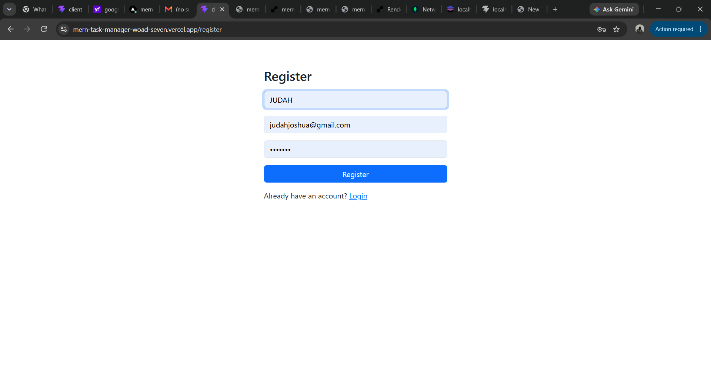
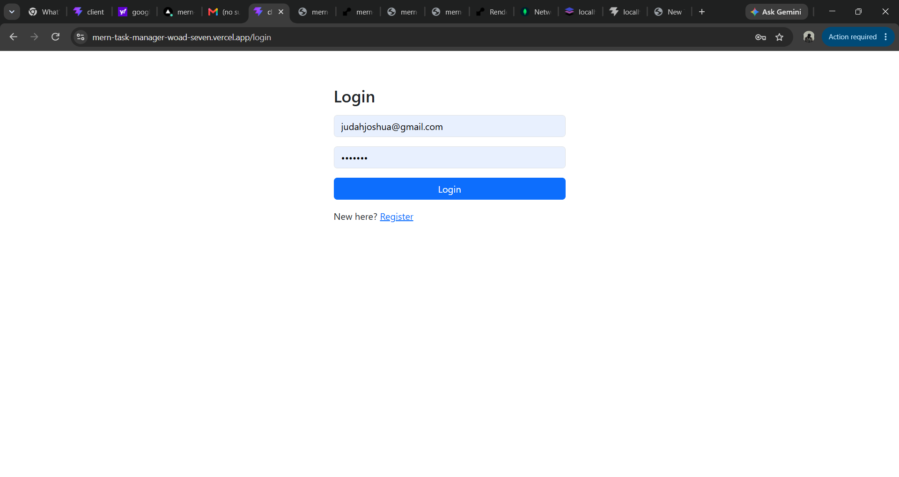
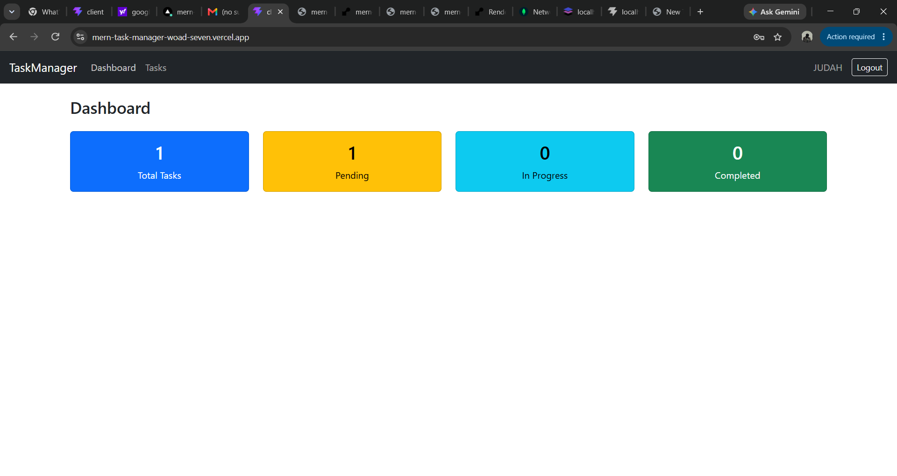
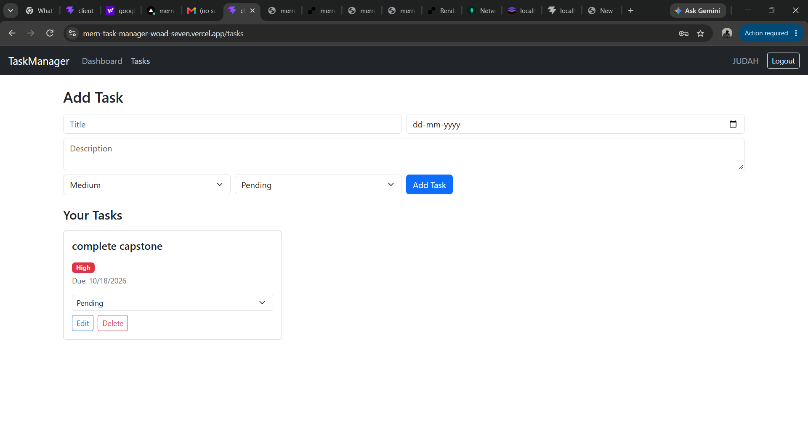

# Full-Stack Task Management Application (MERN)

A task management web app where users can register, log in, and manage their daily tasks from a responsive dashboard.

## Features
- User registration and login with JWT authentication
- Passwords hashed with bcrypt
- Create, view, edit and delete tasks
- Task priority (Low, Medium, High) and status (Pending, In Progress, Completed)
- Dashboard with task summary counts
- Each user sees only their own tasks
- Responsive design (works on mobile)
- Form validation with loading, success and error messages

## Technologies Used
- MongoDB Atlas, Mongoose
- Express.js, Node.js
- React (Vite), React Router, Axios
- Bootstrap
- JWT, bcryptjs

## Local Setup

1. Clone the repository
```
git clone https://github.com/judahjoshua/mern-task-manager.git
cd mern-task-manager
```

2. Backend
```
cd server
npm install
npm run dev
```

3. Frontend (in a new terminal)
```
cd client
npm install
npm run dev
```

4. Open http://localhost:5173

## Environment Variables

Create `server/.env`:
```
MONGO_URI=
JWT_SECRET=
PORT=5000
CLIENT_URL=
```

Create `client/.env` (for deployment):
```
VITE_API_URL=
```

## API Endpoints

| Method | Endpoint | Description |
|--------|----------|-------------|
| POST | /api/auth/register | Create a new account |
| POST | /api/auth/login | Log in and get a token |
| GET | /api/tasks | Get the logged-in user's tasks |
| POST | /api/tasks | Create a task |
| PUT | /api/tasks/:id | Update a task |
| DELETE | /api/tasks/:id | Delete a task |

## Screenshots





## Live Demo
Live app: https://mern-task-manager-woad-seven.vercel.app

Backend API: https://mern-task-manager-6hdv.onrender.com

Demo video: https://drive.google.com/file/d/1R_3ppw_46drI1uoXurvJ1hYsQg8osq__/view?usp=sharing
